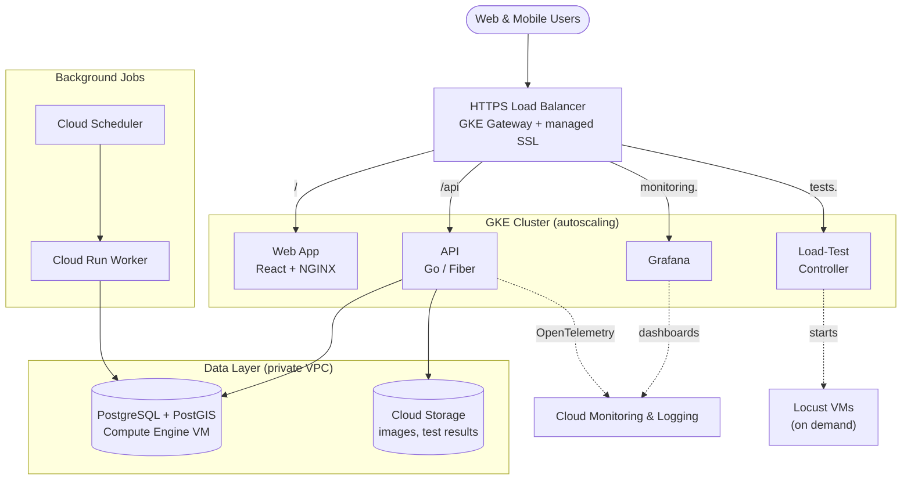
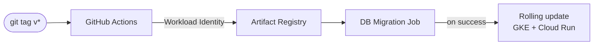

# Social Event Mapper

A platform for discovering, creating, joining, and checking in to social events on a map. One Go API serves a React web app and a React Native mobile app.

- **Live app:** https://socialeventmapper.com
- **API docs (Swagger):** https://socialeventmapper.com/api/docs/

## Cloud Architecture

The production stack runs on **Google Cloud** (`europe-north2`). All infrastructure is defined with Terraform in [`infra/terraform/`](infra/terraform/), and Kubernetes manifests live in [`deploy/kubernetes/`](deploy/kubernetes/).

### Request flow



### Deployment flow



| Component | Role |
|---|---|
| **HTTPS Load Balancer** | Single entry point (GKE Gateway API). Routes `/` to the web app, `/api` to the API, and the `monitoring.` / `tests.` subdomains to Grafana and the test controller. |
| **GKE cluster** | Runs the web app, API, Grafana, OTel Collector, and test controller. Pods scale with HPA; nodes scale with Cluster Autoscaler. |
| **Database VM** | PostgreSQL 16 + PostGIS on a private Compute Engine VM, reachable only inside the VPC. |
| **Cloud Storage** | Event/profile images and load-test results. |
| **Background jobs** | Cloud Scheduler calls the Cloud Run worker: event lifecycle updates every minute, notification cleanup every night. |
| **Observability** | The API sends telemetry through an OTel Collector to Cloud Monitoring/Logging; Grafana visualizes it. |
| **Load testing** | The controller starts temporary Locust VMs that send traffic to the public endpoint and save results to Cloud Storage. |
| **Secret Manager** | Stores the DB password, JWT secret, and API keys. |

**Deployments:** a `v*` tag triggers [`deploy-release.yml`](.github/workflows/deploy-release.yml). It builds images, pushes them to Artifact Registry, runs DB migrations, and then does a rolling update. If migrations fail, nothing is deployed. See [`docs/gcp-operations.md`](docs/gcp-operations.md) for pause/resume and secret access.

## Tech Stack

| Layer | Technology |
|---|---|
| Backend | Go, Fiber, PostgreSQL 16 + PostGIS, golang-migrate, OpenAPI 3.1 |
| Web | React 19, TypeScript, Vite, Google Maps |
| Mobile | React Native, Expo, React Native Maps |
| Infra | GCP, Terraform, GKE, Cloud Run, Docker, NGINX |
| CI/CD | GitHub Actions |

## Repository Layout

| Path | Contents |
|---|---|
| [`backend/`](backend/) | Go API, migrations, tests |
| [`frontend/`](frontend/) | React web app and admin panel |
| [`mobile/`](mobile/) | Expo mobile app |
| [`infra/terraform/`](infra/terraform/) | GCP infrastructure |
| [`deploy/`](deploy/) | Docker Compose (local) and Kubernetes manifests |
| [`nginx/`](nginx/) | NGINX configs |
| [`docs/`](docs/) | OpenAPI specs, architecture, database docs |

## Run Locally

Requires Docker with Compose.

```bash
cp deploy/.env.example deploy/.env   # set DB_PASSWORD, JWT_SECRET, VITE_GOOGLE_MAPS_WEB_API_KEY
docker compose -f deploy/docker-compose.local.yml up --build
```

- Web app: http://localhost
- API: http://localhost/api (health: `/api/health`)
- Swagger UI: http://localhost/api/docs/
- PostgreSQL: `127.0.0.1:5433`, database `sem`, user `postgres`

Email and push notifications use mock providers locally. Use `down -v` to reset the database.

**Admin user:** register normally, then promote the account and log in again:

```bash
docker compose -f deploy/docker-compose.local.yml exec postgres \
  psql -U postgres -d sem -c "UPDATE app_user SET role = 'ADMIN' WHERE email = '<email>';"
```

**Mobile app:**

```bash
cd mobile && npm install && cp .env.example .env && npx expo start
```

Use `http://10.0.2.2/api` on the Android emulator. On a physical device, set `EXPO_PUBLIC_API_BASE_URL=http://<your-LAN-IP>/api` in `mobile/.env`.

## Tests

```bash
cd backend  && ./shipcheck.sh            # SKIP_INTEGRATION=1 if Docker is unavailable
cd frontend && npm install && npm run build && npm test
cd mobile   && npm install && npm test   # E2E: npm run test:e2e (Maestro)
```

## Further Reading

- [Backend architecture](docs/backend/architecture.md) · [Business flows](docs/backend/business-flows/)
- [Database guide](docs/db/database.md)
- [Local stack & configuration](docs/deploy.md)
- [GCP operations](docs/gcp-operations.md)
- [Conventions](docs/conventions.md)
