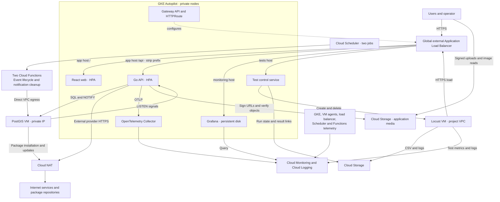

# CMPE 48A Cloud Computing · Term Project Phase 1

**Project** — Social Event Mapper\
**Student** — Mehmet Kaan Ünsel\
**Student number** — 2022400123\
**Partner** — None (individual project)\
**Application source** — [github.com/kaanunsel/social-event-mapper](https://github.com/kaanunsel/social-event-mapper)

## Tentative cloud architecture

Social Event Mapper helps users discover and join nearby events. A GKE Gateway will configure a single public HTTPS load balancer. An HTTPRoute will send `/` and static assets to the React web pods and `/api/*` to the Go API pods, stripping the `/api` prefix. Each Deployment will have its own Horizontal Pod Autoscaler (HPA), initially with 1–3 web replicas and 1–4 API replicas. [GKE Gateway documentation](https://docs.cloud.google.com/kubernetes-engine/docs/how-to/deploying-gateways)

A separate Compute Engine VM with a private IP and persistent disk will host PostgreSQL with PostGIS for spatial queries. PostgreSQL `LISTEN/NOTIFY` will distribute live notification signals across API replicas. Cloud Scheduler will invoke two second-generation Cloud Functions. One will advance event statuses every minute and the other will remove expired notifications daily. Both will reach PostgreSQL over Direct VPC egress. Terraform will provision the GCP infrastructure, and Kubernetes manifests will define workloads and routing. [PostgreSQL LISTEN](https://www.postgresql.org/docs/16/sql-listen.html) · [Cloud Functions Direct VPC egress](https://docs.cloud.google.com/functions/docs/running/direct-vpc)

Locust will simulate event discovery, detail views and participation through the public HTTPS endpoint. The evaluation will compare fixed and autoscaled API replicas under the same load and record p95 latency, throughput, error rate, CPU, memory and replica count. A dedicated Compute Engine VM in the project VPC will run Locust in headless mode on startup, upload CSV results and execution logs to Cloud Storage, and be deleted after each experiment. [Locust CSV output](https://docs.locust.io/en/stable/retrieving-stats.html)

Grafana will run as a single GKE pod with persistent storage and a login-protected monitoring hostname on the same load balancer. It will visualize infrastructure metrics, application logs and load-test results from Cloud Monitoring and Cloud Logging. A separate authenticated test control service will create Locust VMs, record test parameters and run identifiers, provide result links and clean up completed or failed runs. An OpenTelemetry Collector will export application telemetry to GCP. Dashboards will link to the test control interface. [Grafana Monitoring integration](https://grafana.com/docs/grafana/latest/datasources/google-cloud-monitoring/) · [Cloud Logging plugin](https://grafana.com/grafana/plugins/googlecloud-logging-datasource/)

The agreed network design uses private GKE nodes and a private PostgreSQL VM. Public application access is through the HTTPS load balancer; Grafana and test control require authentication. Cloud NAT is included for the chosen private-node design to support private VM package installation and updates, and Resend calls if real email delivery is enabled. Browser-side map, geocoding and weather calls use the user's connection. Functions will use private-ranges-only VPC egress for database access. [Autopilot networking](https://docs.cloud.google.com/kubernetes-engine/docs/concepts/autopilot-overview) · [Direct VPC egress](https://docs.cloud.google.com/functions/docs/running/direct-vpc)

Application images will move from DigitalOcean Spaces to a regional Cloud Storage bucket. The API will issue signed upload URLs and verify object metadata through Google APIs. Clients will upload directly to Cloud Storage. Application media and test results will use separate buckets. [Cloud Storage signed URLs](https://docs.cloud.google.com/storage/docs/access-control/signed-urls)

## Estimated GCP cost

Planning estimate in USD using public on-demand rates for Iowa (`us-central1`). Both scenarios assume continuous deployment for 168 or 720 hours, with one web and one API pod at baseline. The web pod requests 0.25 vCPU and 0.5 GiB RAM, and the API pod requests 0.50 vCPU and 1 GiB RAM. Grafana requests 0.25 vCPU and 1 GiB RAM. The test control service and telemetry collector each request 0.25 vCPU and 0.5 GiB RAM. All five baseline pods request 1 GiB of ephemeral storage each. Grafana uses a 10 GiB balanced persistent disk. The load-test estimate assumes 8 or 24 hours at the proposed HPA maxima, with the Locust VM running for the same test windows. Both functions use request-based billing with zero minimum instances. The 30-day scenario assumes 43,230 scheduled invocations and an average of 3 billable seconds at 1 vCPU and 0.5 GiB per invocation, including startup. This is approximately 129,690 vCPU-seconds and 64,845 GiB-seconds before retries.

| Component and pricing basis | 7 days | 30 days |
|---|---:|---:|
| Web and API baseline pods | $6.89 | $29.55 |
| Grafana pod | $2.72 | $11.65 |
| Test control service pod | $2.31 | $9.88 |
| OpenTelemetry Collector pod | $2.31 | $9.88 |
| Grafana persistent disk, 10 GiB | $0.23 | $0.99 |
| Application media, 10 GiB regional Standard Cloud Storage | $0.05 | $0.20 |
| Additional pods during load tests | $0.88 | $2.63 |
| On-demand Locust VM, one `e2-medium` with a 10 GiB disk and outbound IPv4 | $0.32 | $0.96 |
| PostGIS VM, one `e2-medium` at $0.03351/hour | $5.63 | $24.12 |
| VM storage, 30 GiB of balanced Persistent Disk | $0.69 | $2.96 |
| Global HTTPS load balancer, one forwarding rule at $0.025/hour | $4.20 | $18.00 |
| Cloud NAT and one NAT IPv4, allowance for four private VM/node equivalents | $1.78 | $7.63 |
| Two Cloud Functions and two Scheduler jobs, assuming available free allowances | $0.00 | $0.00 |
| Allowance for load balancer data processing, egress, logs, builds, image storage, test-result storage and short-lived jobs | $5.00 | $20.00 |
| GKE management at $0.10/hour, before free-tier credit | $16.80 | $72.00 |
| **Total before GKE management credit** | **$49.80** | **$210.45** |
| **Estimated total with available GKE management credit** | **$33.00** | **$138.45** |

Prices checked on 12 November 2026. Totals use unrounded amounts. The NAT charge assumes explicitly configured private GKE nodes and a private database VM. Private Google Access supports eligible Google APIs. The NAT estimate depends on actual Autopilot node count. The usage allowance covers small demo traffic and telemetry volumes, including NAT data processing, media operations and image delivery. Application media capacity is budgeted separately at 10 GiB, using $0.000027397 per GiB-hour before storage free-tier offsets. Free-tier availability and the remaining trial balance will be verified before deployment. The GKE free tier provides up to $74.40 per billing account per month toward eligible cluster management fees. Both scenarios fit the $300 project budget even without that credit under the stated assumptions. The usage allowance is a planning estimate and will be refined once traffic is measured. Before provisioning, the project will set billing alerts and verify credit availability. Temporary resources will be removed after testing. [GKE pricing](https://cloud.google.com/kubernetes-engine/pricing) · [VM pricing](https://cloud.google.com/products/compute/pricing/general-purpose) · [Disk pricing](https://cloud.google.com/compute/disks-image-pricing) · [Load balancing pricing](https://cloud.google.com/load-balancing/pricing) · [Cloud Run pricing](https://cloud.google.com/run/pricing) · [Scheduler pricing](https://cloud.google.com/scheduler/pricing) · [VPC pricing](https://cloud.google.com/vpc/network-pricing) · [Cloud NAT pricing](https://cloud.google.com/nat/pricing) · [Cloud Storage pricing](https://cloud.google.com/storage/pricing) · [Observability pricing](https://cloud.google.com/products/observability/pricing)

### Optional database read replicas

The initial deployment will use a single PostgreSQL VM. If load tests show that read traffic is a bottleneck, the database can add one read replica and scale to two if needed. PostgreSQL streaming replication would allow selected read queries to use hot standbys. Writes and reads that require fresh results would stay on the primary. [PostgreSQL high availability and replication](https://www.postgresql.org/docs/16/high-availability.html)

| Optional capacity | Added cost, 7 days | Added cost, 30 days |
|---|---:|---:|
| One read replica, `e2-medium` with a 30 GiB disk | $6.32 | $27.08 |
| Two read replicas, same size per VM | $12.64 | $54.17 |

The replica estimates cover continuous VM and disk usage. Cross-zone replication traffic, backups and any automated failover infrastructure would add costs.
