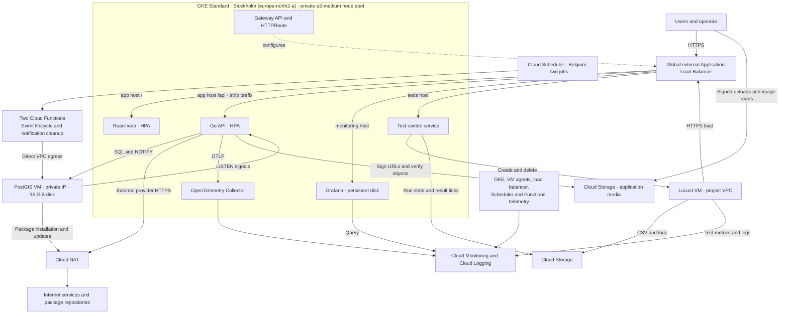

# CMPE 48A Cloud Computing · Term Project Phase 1

**Project** — Social Event Mapper\
**Student** — Mehmet Kaan Ünsel\
**Student number** — 2022400123\
**Partner** — None (individual project)\
**Application source** — [github.com/kaanunsel/social-event-mapper](https://github.com/kaanunsel/social-event-mapper)

## Tentative cloud architecture

Social Event Mapper helps users discover and join nearby events. A zonal GKE Standard cluster in Stockholm (`europe-north2-a`) will run a managed private node pool of `e2-medium` worker VMs with Cluster Autoscaler enabled, giving explicit control over node sizing, boot disks, scaling bounds and pod scheduling. A GKE Gateway will configure a single public HTTPS load balancer. An HTTPRoute will send `/` and static assets to the React web pods and `/api/*` to the Go API pods, stripping the `/api` prefix. Each Deployment will have its own Horizontal Pod Autoscaler (HPA), initially with 1–3 web replicas and 1–4 API replicas, backed by node pool autoscaling from 2 baseline nodes up to 4 nodes under load. [GKE Standard cluster architecture](https://docs.cloud.google.com/kubernetes-engine/docs/concepts/cluster-architecture) · [GKE Gateway documentation](https://docs.cloud.google.com/kubernetes-engine/docs/how-to/deploying-gateways)

A separate Compute Engine VM with a private IP and persistent disk will host PostgreSQL with PostGIS for spatial queries. PostgreSQL `LISTEN/NOTIFY` will distribute live notification signals across API replicas. Cloud Scheduler will invoke two second-generation Cloud Functions. One will advance event statuses every minute and the other will remove expired notifications daily. Both will reach PostgreSQL over Direct VPC egress. Terraform will provision the GCP infrastructure, and Kubernetes manifests will define workloads and routing. [PostgreSQL LISTEN](https://www.postgresql.org/docs/16/sql-listen.html) · [Cloud Functions Direct VPC egress](https://docs.cloud.google.com/functions/docs/running/direct-vpc)

Locust will simulate event discovery, detail views and participation through the public HTTPS endpoint. The evaluation will compare fixed and autoscaled API replicas under the same load and record p95 latency, throughput, error rate, CPU, memory and replica count. A dedicated Compute Engine VM in the project VPC will run Locust in headless mode on startup, upload CSV results and execution logs to Cloud Storage, and be deleted after each experiment. [Locust CSV output](https://docs.locust.io/en/stable/retrieving-stats.html)

Grafana will run as a single GKE pod with persistent storage and a login-protected monitoring hostname on the same load balancer. It will visualize infrastructure metrics, application logs and load-test results from Cloud Monitoring and Cloud Logging. A separate authenticated test control service will create Locust VMs, record test parameters and run identifiers, provide result links and clean up completed or failed runs. An OpenTelemetry Collector will export application telemetry to GCP. Dashboards will link to the test control interface. [Grafana Monitoring integration](https://grafana.com/docs/grafana/latest/datasources/google-cloud-monitoring/) · [Cloud Logging plugin](https://grafana.com/grafana/plugins/googlecloud-logging-datasource/)

The agreed network design uses a GKE Standard private node pool and a private PostgreSQL VM. Public application access is through the HTTPS load balancer; Grafana and test control require authentication. Cloud NAT is included for the chosen private-node design to support node and private VM package installation and updates, and Resend calls if real email delivery is enabled. Browser-side map, geocoding and weather calls use the user's connection. Functions will use private-ranges-only VPC egress for database access. [GKE private clusters](https://docs.cloud.google.com/kubernetes-engine/docs/how-to/private-clusters) · [Direct VPC egress](https://docs.cloud.google.com/functions/docs/running/direct-vpc)

Application images will move from DigitalOcean Spaces to a regional Cloud Storage bucket. The API will issue signed upload URLs and verify object metadata through Google APIs. Clients will upload directly to Cloud Storage. Application media and test results will use separate buckets. [Cloud Storage signed URLs](https://docs.cloud.google.com/storage/docs/access-control/signed-urls)

## Estimated GCP cost

Planning estimate in USD for Stockholm (`europe-north2`), the lowest-cost European region for the selected Compute Engine E2 rates in the official tables. Regional and zonal (`europe-north2-a`) application resources are colocated there. Cloud Scheduler runs in Belgium (`europe-west1`) and invokes the Stockholm functions over authenticated HTTPS because Scheduler does not currently list Stockholm. The load balancer is global. [Scheduler locations](https://docs.cloud.google.com/scheduler/docs/locations)

In GKE Standard mode, compute and boot storage are billed per Compute Engine worker node VM and attached Persistent Disk rather than per-pod Autopilot resource requests. Each `e2-medium` node (2 shared vCPUs / 1 vCPU base, 4 GiB RAM) is configured with a 20 GiB balanced persistent boot disk (overriding the 100 GiB GKE default) and provides roughly 1.93 vCPU and 2.85 GiB allocatable memory after kubelet/OS reservations. The two deployment windows are 168 and 720 hours. Baseline web (`0.25 vCPU`, `0.5 GiB`) and API (`0.50 vCPU`, `1 GiB`) pods total 0.75 vCPU and 1.5 GiB RAM, fitting on one `e2-medium` worker node in the application-only scenario. Adding Grafana (`0.25 vCPU`, `1 GiB`), the OTel Collector (`0.25 vCPU`, `0.5 GiB`) and the test controller (`0.25 vCPU`, `0.5 GiB`) adds 0.75 vCPU and 2 GiB RAM, requiring a second baseline `e2-medium` node in the full architecture. Load tests run for 8/24 hours at the proposed HPA maxima (+2 vCPU and +4 GiB RAM across extra web/API replicas), during which GKE Cluster Autoscaler adds up to two burst `e2-medium` nodes; the Locust VM exists only during those windows. PostgreSQL uses one 15 GiB balanced persistent boot disk for the OS, data and WAL, mounted on the database VM and billed separately from VM compute. Application images live in GCS.

**Core application infrastructure**

| Component and pricing basis | 7 days | 30 days |
|---|---:|---:|
| GKE Standard baseline node (web + API) - 1x e2-medium | $5.91 | $25.33 |
| GKE baseline node boot disk - 20 GiB balanced PD | $0.46 | $1.97 |
| PostGIS database VM - e2-medium compute | $5.91 | $25.33 |
| Database VM disk - 15 GiB balanced PD (OS + data) | $0.35 | $1.48 |
| Application images - 10 GiB Standard Cloud Storage | $0.05 | $0.23 |
| Public HTTPS application load balancer | $4.20 | $18.00 |
| Private-resource egress - Cloud NAT + NAT IPv4 | $1.78 | $7.63 |
| Event/cleanup functions + two Scheduler jobs* | $0.00 | $0.00 |
| Application traffic, builds and artifacts allowance | $3.00 | $12.00 |

**Monitoring and load-test infrastructure (additional cost)**

| Component and pricing basis | 7 days | 30 days |
|---|---:|---:|
| GKE node for Grafana, OTel + test control - 1x e2-medium | $5.91 | $25.33 |
| Monitoring/control node boot disk - 20 GiB balanced PD | $0.46 | $1.97 |
| Grafana dashboard storage - 10 GiB balanced PD | $0.23 | $0.99 |
| Autoscaled GKE nodes during load tests - 2x e2-medium + disks | $0.61 | $1.82 |
| Locust VM + 10 GiB disk + IPv4 (8 / 24 hours) | $0.33 | $1.00 |
| Extra telemetry, test traffic and results allowance | $2.00 | $8.00 |
| **Additional subtotal** | **$9.54** | **$39.11** |

**Scenario totals**

| Deployment scenario | 7 days | 30 days |
|---|---:|---:|
| Without monitoring/load tests - with GKE credit | $21.66 | $91.97 |
| With monitoring/load tests - with GKE credit | $31.20 | $131.08 |
| Without monitoring/load tests - before GKE credit | $38.46 | $163.97 |
| With monitoring/load tests - before GKE credit | $48.00 | $203.08 |

The full architecture remains the implementation plan. The application-only scenario uses a single baseline `e2-medium` node and excludes the second baseline node (hosting Grafana, the collector and the test controller), Grafana's PVC, Locust, test-induced node scaling and the extra usage allowance; native GCP platform telemetry remains available. HPA and Cluster Autoscaler remain enabled, with ordinary application traffic fitting on baseline node capacity. Both scenarios retain the same conservative NAT allowance for four private VM/node equivalents.

Rates: Compute Engine `e2-medium` $0.035180998/hour; balanced PD $0.000136986/GiB-hour; GCS Standard $0.000031507/GiB-hour. Load balancing is $0.025/hour; NAT plus its IPv4 is budgeted at $0.0106/hour. Zonal GKE Standard cluster management adds $0.10/hour ($16.80/$72.00) before the available billing-account free tier credit (up to $74.40/month, which fully covers one zonal Standard cluster). Totals use unrounded values.

*Functions assume zero minimum instances, 1 vCPU/0.5 GiB, an average three billable seconds per call and available free allowances. At 43,230 calls in 30 days, this is 129,690 vCPU-seconds and 64,845 GiB-seconds before retries. Scheduler assumes its two jobs fit the available free allowance. Variable allowances are planning budgets, not fixed service prices: $3/$12 for application traffic, NAT/LB processing, builds and artifacts, plus $2/$8 for extra telemetry, test traffic and result storage. Actual node count, traffic, kubelet reservations and free-tier availability must be checked at deployment. Both windows fit the $300 project budget under these assumptions; repeated deployments consume the same remaining trial balance.

Prices checked 15 November 2026. [GKE pricing](https://cloud.google.com/kubernetes-engine/pricing) · [VM pricing](https://cloud.google.com/products/compute/pricing/general-purpose) · [Disk pricing](https://cloud.google.com/compute/disks-image-pricing) · [Load balancing pricing](https://cloud.google.com/load-balancing/pricing) · [Cloud Run pricing](https://cloud.google.com/run/pricing) · [Scheduler pricing](https://cloud.google.com/scheduler/pricing) · [Cloud NAT pricing](https://cloud.google.com/nat/pricing) · [Cloud Storage pricing](https://cloud.google.com/storage/pricing) · [Observability pricing](https://cloud.google.com/products/observability/pricing)

### Optional database read replicas

The initial deployment will use a single PostgreSQL VM. If load tests show that read traffic is a bottleneck, the database can add one read replica and scale to two if needed. PostgreSQL streaming replication would allow selected read queries to use hot standbys. Writes and reads that require fresh results would stay on the primary. [PostgreSQL high availability and replication](https://www.postgresql.org/docs/16/high-availability.html)

| Optional capacity | Added cost, 7 days | Added cost, 30 days |
|---|---:|---:|
| One read replica, `e2-medium` with a 15 GiB disk | $6.26 | $26.81 |
| Two read replicas, same size per VM | $12.51 | $53.62 |

The replica estimates cover continuous VM and disk usage. Cross-zone replication traffic, backups and any automated failover infrastructure would add costs.
