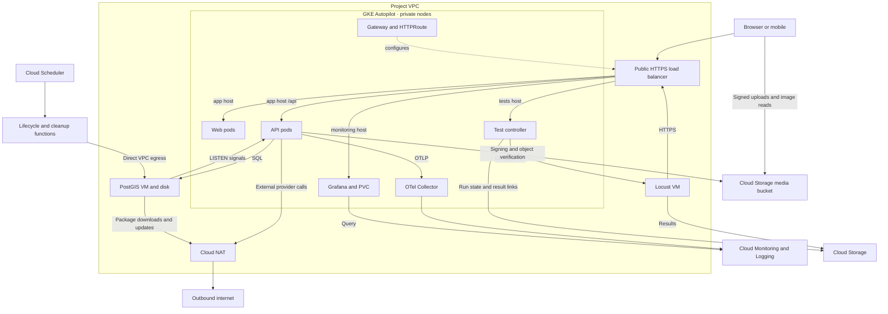
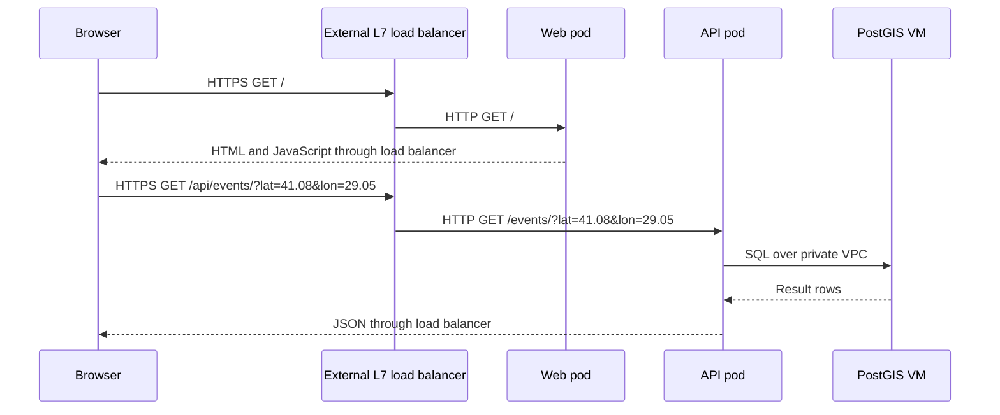
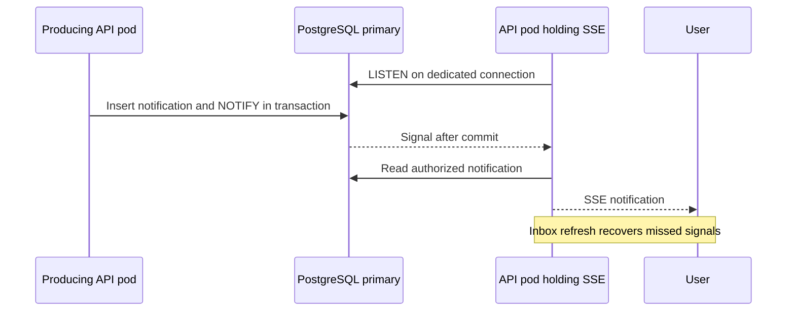
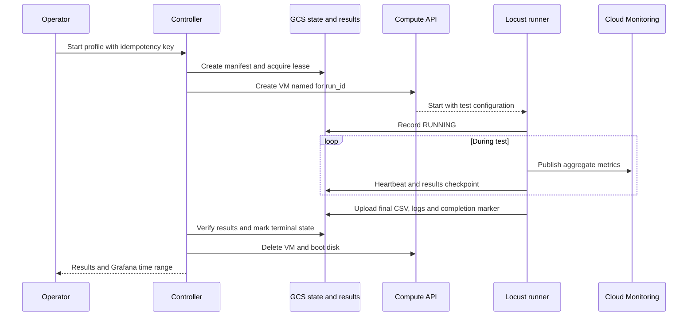

# CMPE 48A cloud implementation plan

This plan describes implementation following Phase 1. Sizes, schedules and example hostnames are initial choices to validate. The [Phase 1 report](cmpe48a-phase-1.md) contains the submission summary and estimated costs.

## Architecture and resource ownership

Terraform will provision GCP resources in us-central1. Kubernetes manifests will define workloads and routing. The GKE Gateway controller will own the load balancer configuration generated from Gateway and HTTPRoute resources. The test control service will own temporary Locust instances created from a Terraform-managed instance template.

| Component | Deployment | Initial capacity |
|---|---|---|
| React web | GKE Deployment | 0.25 vCPU, 0.5 GiB, HPA 1–3 |
| Go API | GKE Deployment | 0.5 vCPU, 1 GiB, HPA 1–4 |
| Grafana | GKE Deployment | One replica, 0.25 vCPU, 1 GiB, 10 GiB PVC |
| Test controller | GKE Deployment | One replica, 0.25 vCPU, 0.5 GiB |
| OTel Collector | GKE Deployment | One replica, 0.25 vCPU, 0.5 GiB |
| PostGIS VM | Compute Engine | e2-medium, private IP, 30 GiB total disk |
| Locust VM | Temporary Compute Engine instance | e2-medium, 10 GiB disk, ephemeral external IPv4 |
| Lifecycle function | Cloud Functions 2nd gen | Every minute, minimum instances zero |
| Cleanup function | Cloud Functions 2nd gen | Daily, minimum instances zero |

Every baseline pod requests 1 GiB ephemeral storage. Grafana uses a single-writer volume and recreate rollout strategy. Dashboard JSON and data-source configuration live in version control. Initial CPU-based HPA targets will be tuned with measurements. Record resources actually admitted by Autopilot and revise estimates accordingly.

The diagram shows principal application flows. VM agents, native service telemetry, Artifact Registry, IAM and secret access are configured alongside these components.

## Routing and network

Use one global external Application Load Balancer through GatewayClass gke-l7-global-external-managed. Example hostnames depend on DNS ownership and certificate validation.

| Host and path | Target | Behavior |
|---|---|---|
| phase1.socialeventmapper.com, / | Web Service | SPA and assets |
| phase1.socialeventmapper.com, /api/* | API Service | Remove /api prefix |
| phase1.socialeventmapper.com, /api/docs/* | Web Service | Packaged Swagger and OpenAPI assets |
| monitoring.socialeventmapper.com | Grafana Service | Require Grafana login |
| tests.socialeventmapper.com | Controller Service | Require operator login |

Give documentation routes explicit precedence over API routes. Bundle Swagger assets with the web image and preserve spec discovery and relative links. Validate HTTPS, health checks, SPA refresh, documentation and SSE timeout behavior. NEGs expose ready pod IPs to the load balancer. Internal Services provide stable discovery addresses.

Allocate non-overlapping subnet, pod and Service ranges. Enable Private Google Access. Use Cloud NAT for private resources requiring internet access, including software downloads and external integrations. Functions use private-ranges-only Direct VPC egress to reach PostgreSQL; public-destination function traffic uses the serverless outbound path. The runner uses its ephemeral external IP for public HTTPS load tests. Restrict database access to intended workload sources and use IAP-based administration for private VMs.

## Egress decision and repository evidence

Reviewed on 12 November 2026. Autopilot defaults to public networking. Public-node Autopilot instances have external IP addresses and support internet egress through node masquerading. Pod IPs remain drawn from the pod address range. Enabling private nodes removes node external IPs. Control-plane endpoint access is a separate setting. [Autopilot overview](https://docs.cloud.google.com/kubernetes-engine/docs/concepts/autopilot-overview) · [Public Autopilot node IPs](https://docs.cloud.google.com/kubernetes-engine/docs/troubleshooting/cluster-creation) · [IP masquerading](https://docs.cloud.google.com/kubernetes-engine/docs/concepts/ip-masquerade-agent)

The confirmed network decision enables private GKE nodes and keeps the database VM private. For this choice, Cloud NAT provides the general internet egress required by database package bootstrap/updates and any enabled Resend delivery. Media storage will use GCS and eligible Google API routing. Public-node Autopilot can run general internet backend calls without Cloud NAT. It would still leave the private database's package installation and updates to solve, through database-only NAT, a prepared image/package mirror or external-IP provisioning. The current estimate retains one shared NAT gateway and makes its private-node assumption explicit.

| Call or dependency | Execution location and evidence | Network implication |
|---|---|---|
| Resend email API | [Resend provider](../backend/internal/adapter/in/email/provider_resend.go), SendWithContext | Server-side HTTPS when mail_provider=resend. Local configuration currently uses mock mail. |
| DigitalOcean Spaces object validation | [Spaces adapter](../backend/internal/adapter/in/spaces/storage.go), ObjectExists calls HeadObject | Current source behavior; replace with GCS metadata lookup in the planned deployment. |
| Signed image uploads | Same adapter signs requests; clients perform PUT | Current source behavior; migrate to GCS V4 signing and object verification. Clients will upload to GCS. |
| Firebase OAuth and FCM | [Push provider](../backend/internal/adapter/in/firebasepush/provider.go) | Server-side Google API calls when Firebase is selected. Local configuration uses mock push. Verify supported Google API routing through Private Google Access. |
| OTLP telemetry | [OTel setup](../backend/internal/infrastructure/observability/otel.go) | Configurable endpoint. The proposed deployment uses the internal collector and GCP exporters. |
| Google Maps | [Web provider](../frontend/src/components/GoogleMapsProvider.tsx) | Browser connection. |
| Photon and OSRM | [Web service](../frontend/src/services/eventService.ts), [mobile service](../mobile/src/services/eventService.ts) | Browser or mobile connection. |
| Open-Meteo weather | [Discover view](../frontend/src/views/discover/DiscoverPage.tsx) | Browser connection. |
| PostgreSQL, PostGIS, Ops Agent installation and OS updates | Planned database VM bootstrap | Public package repositories need general internet egress unless packages/images are staged privately. |
| Grafana plugins and container images | Planned image build and registry | Bake plugins into images; Artifact Registry pulls use eligible Google API access. |

The review uses tracked source and example configuration. Enabled providers in a future GCP environment will be selected at deployment. Calls to arbitrary Resend or Debian endpoints cannot be covered by Private Google Access alone. Google documents Debian images using the Debian CDN for APT packages. [Google API private access](https://docs.cloud.google.com/vpc/docs/private-google-access) · [Compute Engine OS repositories](https://docs.cloud.google.com/compute/docs/images/os-details)

Configure a default internet route, outbound firewall rules and Cloud NAT coverage for the private DB subnet and applicable GKE source ranges. Preserve default Autopilot masquerading unless a tested policy change requires different NAT coverage. Private DB traffic, LISTEN/NOTIFY and the load balancer's inbound path remain on their respective routes. Functions use private-ranges-only VPC egress, and the public-IP runner uses its own outbound path.

During implementation, verify actual node external-IP settings, DNS, GCS metadata/signing requests, an enabled email-provider call, Google API access, database package downloads and runner access to the public application URL. Check NAT metrics and admitted node count before revising the four-node/VM cost allowance. This source review establishes the proposed configuration; deployment connectivity remains to be tested.

## Identity and provisioning

Use local ADC for Terraform and a restricted, versioned GCS state bucket. Pin providers and images. Enable APIs, IAM and budgets before compute deployment. Use Workload Identity Federation for GKE and attached service accounts for VMs and functions.

Grant Grafana telemetry read access, the collector telemetry write access, the runner access to test configuration/results and metric publishing, and the controller permissions to manage test instances and attach their service account. Store runtime secrets in Secret Manager. Verify plugin authentication with the chosen Grafana version early.

The controller authenticates operators independently of Grafana. Require POST for mutations, CSRF protection and predefined target/profile selection. Credentials stay server-side. Terraform owns the instance template, while the controller creates and removes per-run VMs.

## Cloud Storage migration

Use separate regional buckets for application media and experiment artifacts. Implement a GCS adapter behind the existing image-upload storage port. Use V4 signed upload URLs with Workload Identity and IAM signBlob permission on a scoped signing service account. Replace Spaces HeadObject with GCS object attributes lookup. Remove the Spaces-specific x-amz-acl header from the GCP upload contract and update OpenAPI and both clients where needed. Configure browser CORS and content security policies for the chosen Storage endpoints.

Preserve object ownership, content validation and upload confirmation behavior. Decide read access by media type before implementation. Public event images may use stable public URLs in a dedicated public-media bucket, while private report/evidence objects require authorized signed reads. Persist object keys for signed reads and generate fresh URLs on response, since expiring URLs cannot be used as permanent database values.

Inventory existing Spaces URLs and objects before migration. Copy any retained data to GCS, verify object counts/content and update references with a repeatable mapping. Seeded demo data can be created directly in GCS. Validate browser and mobile upload, confirmation, display and denied access cases. Account for media traffic separately from Locust CSV storage. [Signed URLs](https://docs.cloud.google.com/storage/docs/access-control/signed-urls) · [IAM signing](https://docs.cloud.google.com/storage/docs/authentication/creating-signatures)

## API, functions and notifications

1. Run schema migrations in a release Job before API rollout. Remove migration execution from individual API pod startup for GCP.
2. Reuse existing Go application services in separate lifecycle and cleanup function entry points within the backend module.
3. Remove equivalent API startup timers after validating the functions.
4. Use bounded batches and database locking or leases to prevent overlapping lifecycle executions.
5. Review post-commit badge evaluation for partial failure. Persist pending work or provide reconciliation so retries complete missed effects.
6. Configure Scheduler OIDC authentication and retry policies. Log duration, affected rows and failures.

Store notification records and NOTIFY signals in the same transaction on the primary. Each API pod uses a dedicated LISTEN connection and forwards relevant signals to its local SSE clients. Send only identifiers in signals. Reconnect listeners with backoff, refresh inbox records after disconnection and deduplicate by notification ID. Review the existing synchronous SSE-versus-push decision when moving to asynchronous fan-out.

## Telemetry and Grafana

The existing API exports OTLP logs, metrics and traces through backend/internal/infrastructure/observability/otel.go. Configure its endpoint for the collector, preserving severity and current telemetry contracts. Export metrics and logs to Cloud Monitoring and Logging, and sampled traces to Cloud Trace.

| Source | Collection | Dashboard |
|---|---|---|
| GKE workloads | GKE system metrics and container logs | CPU, memory, restarts, replicas and logs |
| API application | Existing OTLP instrumentation | Latency, errors and structured business logs |
| PostgreSQL VM | Ops Agent system and PostgreSQL receivers | Resources, connections and database logs |
| Locust VM | Ops Agent and periodic test metric publishing | Generator resources, RPS, latency and failures |
| Load balancer | Native metrics and sampled access logs | Status codes, volume and backend health |
| Scheduler and functions | Native telemetry and structured logs | Executions, duration, errors and affected rows |

Install the Cloud Monitoring data source and Google Cloud Logging plugin in a pinned Grafana image. Provision application, infrastructure, scheduled-work and experiment dashboards. Filter test metrics by run_id and time range. Bound test metric cardinality and use route templates. Store detailed request statistics in CSV. Grafana shows published metrics and links to private artifact downloads through the controller.

Validate PVC persistence across Grafana pod replacement. A full GKE outage also affects Grafana and the controller, while cloud telemetry and uploaded artifacts remain available. [Grafana Monitoring integration](https://grafana.com/docs/grafana/latest/datasources/google-cloud-monitoring/) · [Logging plugin](https://grafana.com/grafana/plugins/googlecloud-logging-datasource/) · [PostgreSQL Ops Agent](https://docs.cloud.google.com/stackdriver/docs/solutions/agents/ops-agent/third-party/postgresql)

## Test control and recovery

The controller exposes an authenticated UI/API for start, stop, status, history and result downloads. A Grafana dashboard link opens this UI. It creates a durable run record in GCS and starts a uniquely named VM. Use GCS generation preconditions for state transitions and a lease for one active experiment. Persist Compute operation IDs and reconcile instance existence after ambiguous API responses.

Use uppercase states QUEUED, STARTING, RUNNING, STOPPING, SUCCEEDED and FAILED. Record commit SHA, image digest, dataset seed, user count, spawn rate, duration, timestamps and profile.

Run fixed repository scripts with validated parameters. A stop request changes desired state in the manifest, which the runner polls. Graceful stop uploads partial results. The controller enforces a deadline and cleans up expired VMs after an upload grace period. On restart it reconciles outstanding runs. Label VMs with run_id and expiry and provide an operator cleanup command for prolonged controller outages. Repeated start requests return the same run, and stop/delete operations are idempotent.

Use authenticated downloads or short-lived signed URLs. Retain final report evidence through grading and expire expendable test output using a bucket lifecycle policy.

## Experiments and acceptance

Compare fixed-replica and HPA experiments with identical seeded data, user behavior and load schedules. Include warm-up, steady load and cooldown, and repeat trials. Use separate page/asset traffic to exercise web HPA. Monitor Locust CPU and achieved traffic to detect generator saturation before interpreting server capacity.

Acceptance evidence will demonstrate:

- Valid HTTPS and correct routing for all hosts, including API docs and SSE.
- Web and API HPA scaling with ready endpoints.
- Cross-pod notification delivery and reconnect recovery.
- Safe repeated function execution and visible failure telemetry.
- Metrics and logs for all components, with controlled error checks.
- Controller start, cancel, restart recovery, durable results and VM cleanup.
- CSV totals and Grafana graphs agreeing within documented aggregation differences.
- Reproducible plots backed by run manifests and raw result files.

## Implementation order

| Stage | Work | Verification |
|---|---|---|
| Foundation | State, IAM, APIs, network, NAT and budgets | Terraform plan and connectivity |
| Data and images | DB VM, migrations, Artifact Registry and GCS media adapter | Fresh database and API smoke test |
| Kubernetes | Gateway, routes, Deployments and HPA | Web, API, docs and HTTPS |
| Background work | Functions, schedules and LISTEN/NOTIFY | Retry, overlap and multi-pod tests |
| Observability | Collector, Ops Agent, Grafana and dashboards | Complete telemetry coverage |
| Load automation | Controller, VM template and result storage | Full start-to-cleanup flow |
| Evaluation | Experiments, graphs and demo recording | Report evidence and cost review |

Proposed directories are infra/terraform/, deploy/kubernetes/, observability/grafana/, observability/collector/, load-tests/ and tools/test-control/. Keep function entry points inside the backend Go module to reuse internal application packages. Review package boundaries before implementation. Follow repository surface conventions, update OpenAPI for changed contracts and run backend shipcheck for backend behavior changes.

## Cost and optional capacity

The main estimate is $33.00 for 7 days and $138.45 for 30 days with available GKE management credit, or $49.80/$210.45 without it. These are alternative windows. All deployment periods consume the same remaining trial budget.

The model uses 168/720 deployment hours and 8/24 test hours. Autopilot rates are $0.0445 per requested vCPU-hour, $0.0049225 per GiB-hour and $0.0001389 per ephemeral GiB-hour. Balanced disk costs $0.000136986 per GiB-hour. Application media adds 10 GiB regional Standard GCS at $0.000027397 per GiB-hour, or $0.05/$0.20. Operations and image-delivery traffic use the variable allowance. NAT uses ($0.0014 × 4 + $0.005) per hour, with actual Autopilot node count to verify.

The $5/$20 variable allowance covers modest traffic, NAT/LB processing, telemetry, artifacts and builds. Measure volumes and cardinality during the first test. Function estimates assume three billable seconds per invocation at 1 vCPU and 0.5 GiB, zero minimum instances and available free allowances. Longer calls and retries increase consumption.

Start with one DB VM. Add one read replica if measurements justify it and a second if necessary. Each adds approximately $6.32/$27.08 in VM and disk costs. Keep writes, freshness-sensitive reads and LISTEN/NOTIFY on the primary. Add explicit read pools and measure replication lag. Automated failover requires further design.

Resolve demo usage of Maps, email and push before provisioning and account for enabled provider costs. Use existing domains where available. Verify remaining trial credit, IAM, quotas, selected plugin authentication and admitted resource requests during setup. [GKE pricing](https://cloud.google.com/kubernetes-engine/pricing) · [Disk pricing](https://cloud.google.com/compute/disks-image-pricing) · [NAT pricing](https://cloud.google.com/nat/pricing) · [Observability pricing](https://cloud.google.com/products/observability/pricing)
